# Relay Scheduler 8

**Web-controlled 8-channel relay timer for the Wemos D1 mini (ESP8266), with infrared remote control.**

Version **2.0** · Power by Team DigitalEQ

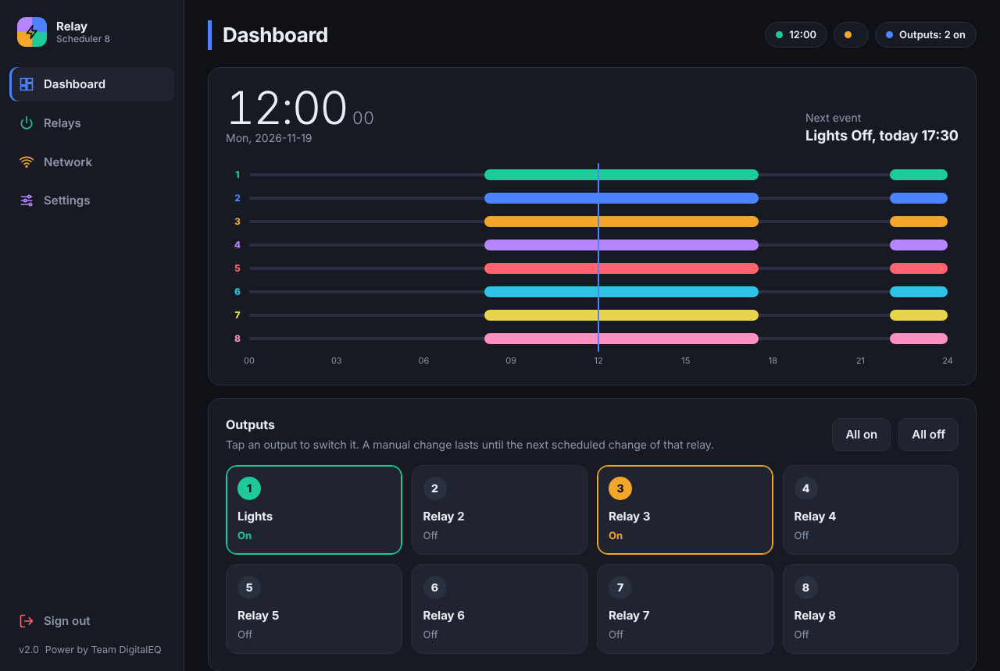

Relay Scheduler 8 switches up to eight relays on and off at the times you set. Every relay has its own
name and its own list of switching periods (up to 24), each with its own weekdays. Everything is
configured from a built-in web page that works on phone, tablet and PC, in eight languages. Any
infrared remote control can be taught to switch the relays by hand. Home Assistant finds the relays by itself
over MQTT.

### Default access

| | |
|---|---|
| **WiFi network** (opened by the device on first start) | `RelayScheduler-XXXXXX` (XXXXXX = last six digits of the chip ID) |
| **WiFi password** | `relay12345` (change it in *Network → Fallback access point password*) |
| **Web address** | http://192.168.4.1 (later also http://relayscheduler.local) |
| **Login** | user `admin`, password `admin`. You must choose a new password at the first sign-in |

---

## Contents

1. [Features](#features)
2. [Hardware](#hardware)
3. [Wiring](#wiring)
4. [Programming the firmware](#programming-the-firmware)
5. [First start](#first-start)
6. [Using the web interface](#using-the-web-interface)
7. [Infrared remote control](#infrared-remote-control)
8. [Home Assistant (MQTT)](#home-assistant-mqtt)
9. [Remote access from the internet](#remote-access-from-the-internet)
10. [Behaviour in detail](#behaviour-in-detail)
11. [Licence and trial](#licence-and-trial)
12. [Updating, backup and factory reset](#updating-and-factory-reset)
13. [Troubleshooting](#troubleshooting)
14. [Technical reference](#technical-reference)
15. [Project structure and building the web page](#project-structure)
16. [Safety](#safety)
17. [Contact](#contact)

---

## Features

| Area | What you get |
|------|--------------|
| **Outputs** | 8 relay outputs, each with a name of your choice and an on/off switch for its schedule |
| **Scheduler** | Up to **24 periods per relay**, each with an ON time, an OFF time and seven weekday buttons. Periods may run past midnight (for example 22:00 to 02:00) |
| **Manual control** | Tap an output on the dashboard to switch it, or use *All on* / *All off*. A manual change lasts until the next scheduled change of that relay |
| **IR remote** | Learn any infrared remote: one button per relay, *all on*, *all off* and *schedule on/off*. 11 buttons in total |
| **Home Assistant** | MQTT with automatic discovery: 8 relay **lights** (or switches, your choice), a *Schedule* switch and a WiFi signal sensor appear in Home Assistant without any YAML. Also works with any other MQTT client (Node-RED, openHAB, ioBroker) |
| **Clock** | Internet time (NTP) with time zone and daylight saving, or the time of your browser when there is no internet |
| **Network** | WiFi station with DHCP or fixed address, fallback access point, `relayscheduler.local` name, optional extra port and DNS name for access from the internet |
| **Security** | Login with salted SHA-256 password, forced password change on first use, lock-out after failed attempts, one signed-in device at a time |
| **Interface** | Responsive interface with colour themes (Midnight, Daylight, AMOLED and your own Custom theme; themes need an activated licence), 8 languages (English, Romanian, Italian, Portuguese, Spanish, German, French, Russian), works without internet access |
| **Maintenance** | Over-the-air firmware update, factory reset from the web page, memory and flash information |
| **Reliability** | All relays start OFF after a power cut and take their scheduled state as soon as the clock is known. Settings are stored with a checksum and flash wear is minimised |

### Screens

The screenshots show demonstration data.

| Sign-in | Dashboard |
|---|---|
| 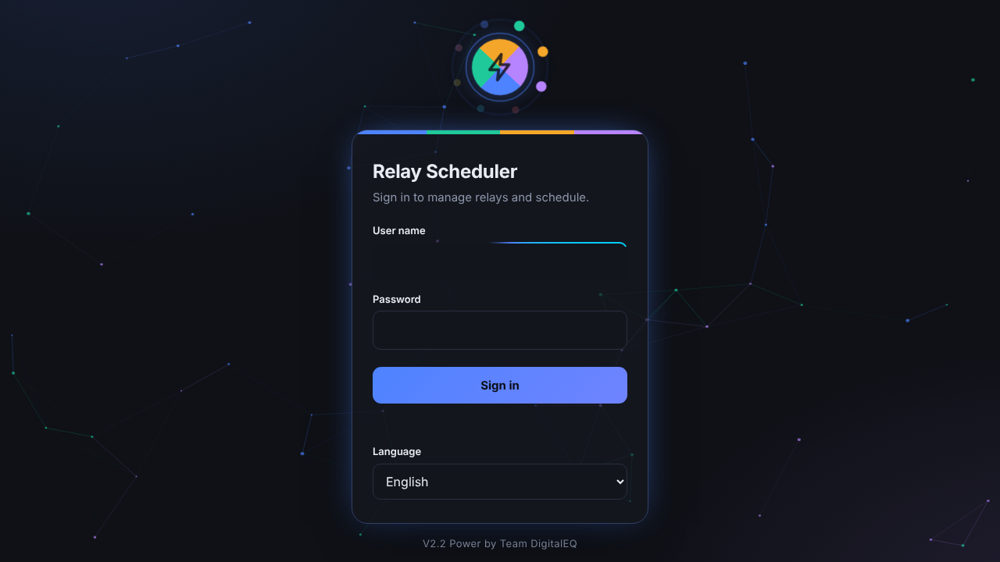 |  |
| **Relays and schedule** | **Network** (WiFi, IP address, remote access, Home Assistant) |
| 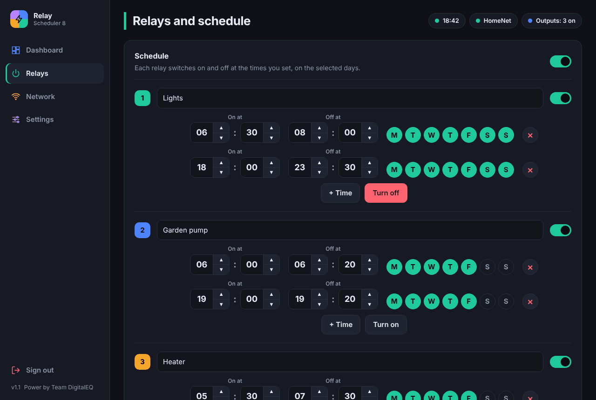 | 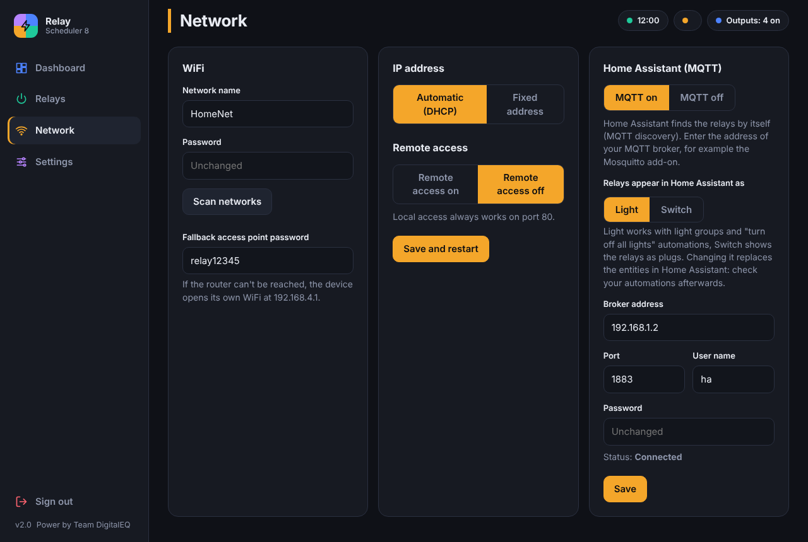 |
| **Settings: General** | **Settings: IR remote** |
| 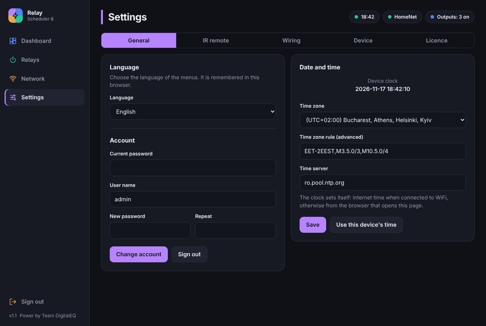 | 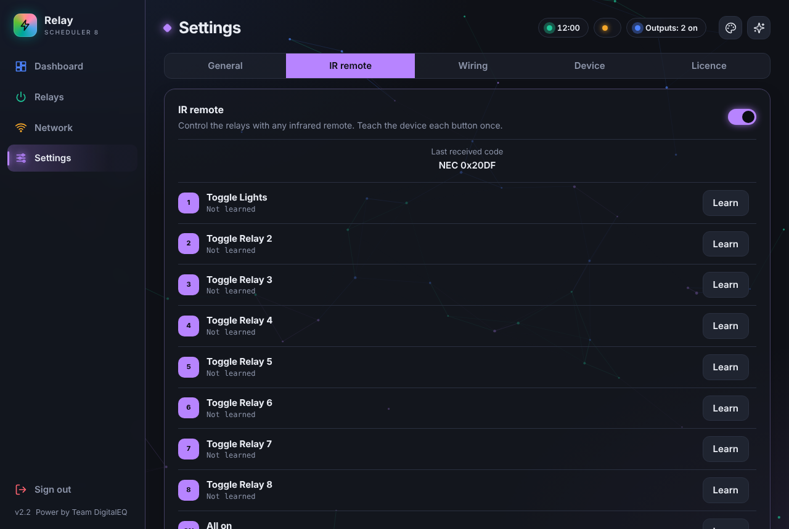 |
| **Settings: Device** | **Settings: Licence** |
| 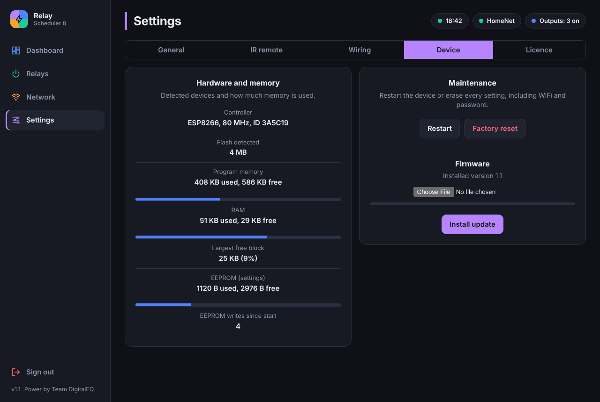 | 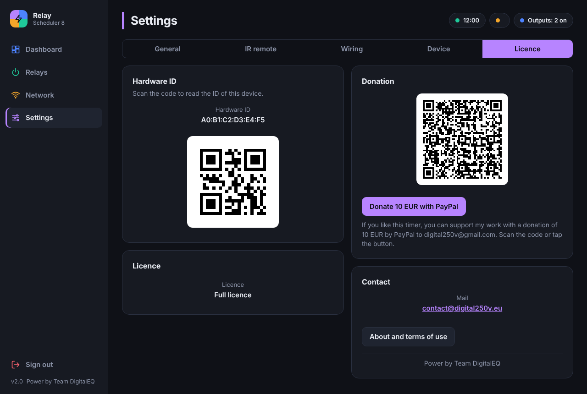 |

**Settings: Wiring** (connection diagram, pin table and connection notes, built into the device):

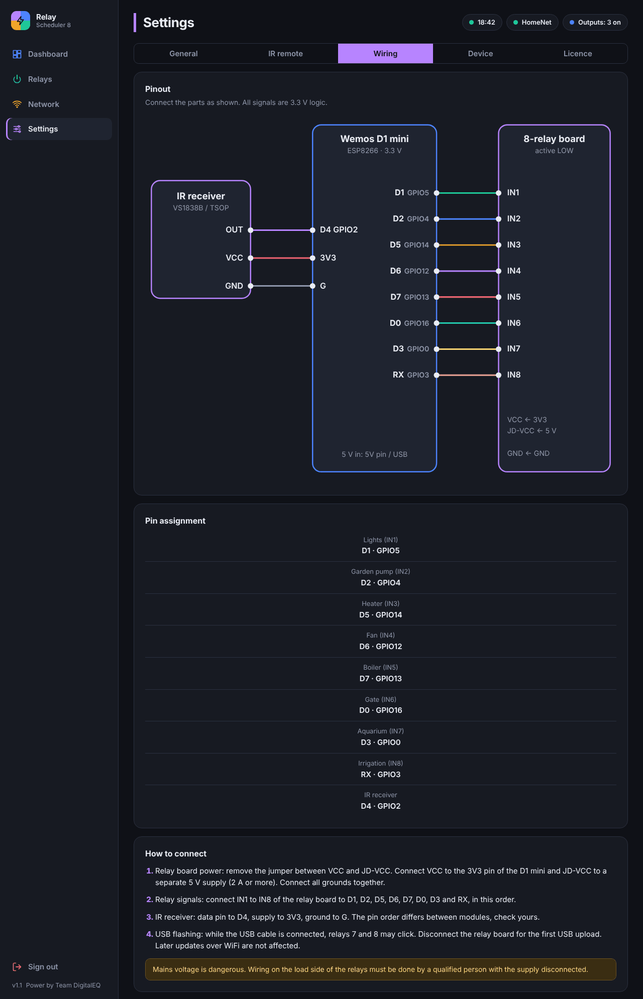

**On a phone:**

| Dashboard | Relays and schedule | IR remote |
|---|---|---|
| 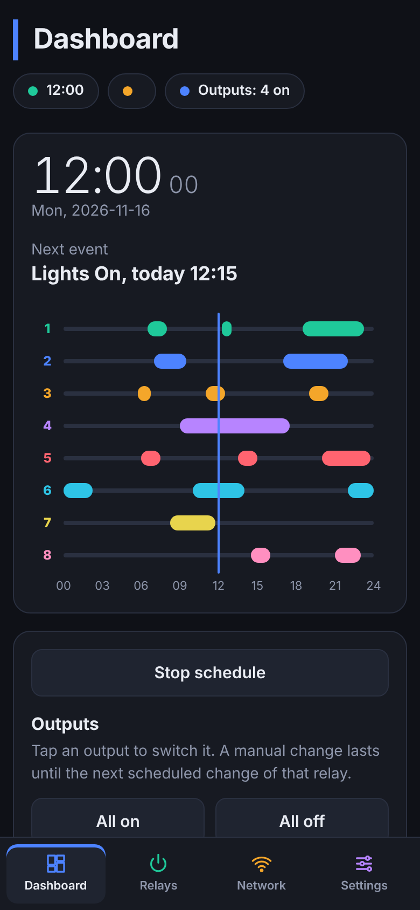 | 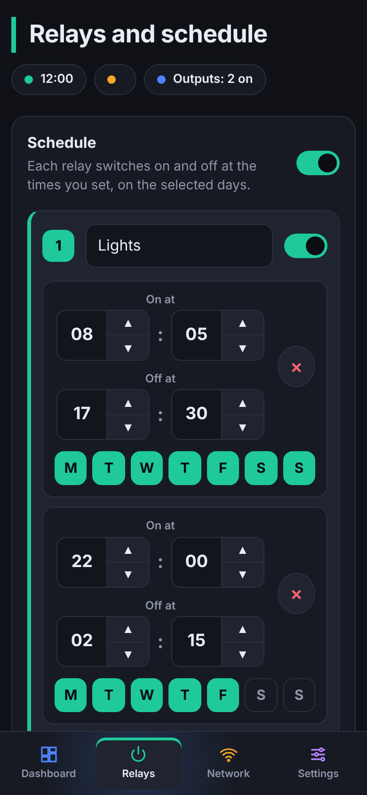 | 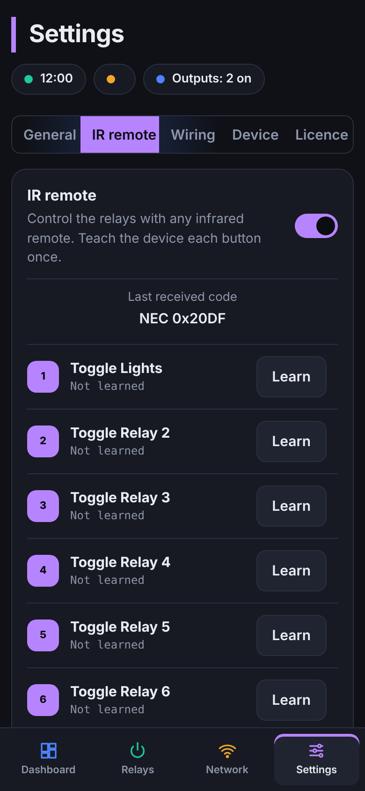 |

---

## Hardware

### Parts

| Qty | Part | Notes |
|----:|------|-------|
| 1 | Wemos D1 mini (ESP8266, 4 MB flash) | LOLIN / WEMOS D1 mini or a compatible clone |
| 1 | 8-channel relay board, 5 V, optocoupler inputs, **active LOW** | The most common type. Active HIGH boards work after one setting (see below) |
| 1 | IR receiver module, 3.3 V compatible | VS1838B, TSOP38238, TSOP4838 or similar, 38 kHz |
| 1 | Any infrared remote control | TV, DVD or LED remotes all work |
| 1 | 5 V power supply, 2 A or more | Powers the D1 mini and the relay coils. Eight coils can draw more than 0.5 A |

### Pin assignment

| Function | D1 mini pin | GPIO | Remark |
|----------|:-----------:|:----:|--------|
| Relay 1 | D1 | 5 | |
| Relay 2 | D2 | 4 | |
| Relay 3 | D5 | 14 | |
| Relay 4 | D6 | 12 | |
| Relay 5 | D7 | 13 | |
| Relay 6 | D0 | 16 | |
| Relay 7 | D3 | 0 | Moves while flashing over USB (see below) |
| Relay 8 | RX | 3 | Moves while flashing over USB (see below) |
| IR receiver, data | D4 | 2 | The blue LED of the D1 mini blinks with every IR signal |

These pins hold a safe level while the module starts, so **the relays do not click at power-up**.

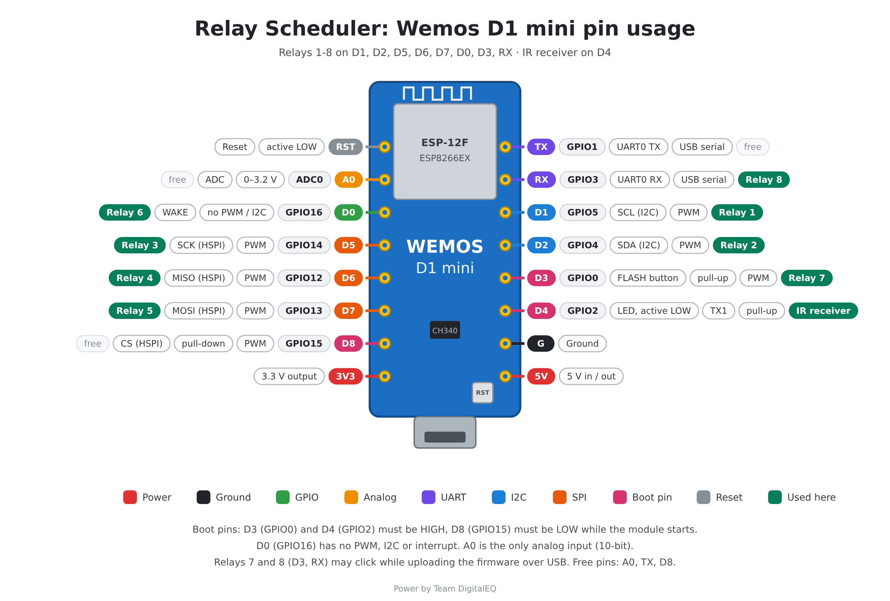

The general pinout of the board is in [`docs/wemos_d1_mini_pinout.png`](docs/wemos_d1_mini_pinout.png).

The pins are listed in `Config.h` (`RELAY_PIN`, `IR_PIN`). If your relay board switches ON when its
input is HIGH, set `RELAY_ACTIVE_LOW` to `0` there and recompile.

---

## Wiring

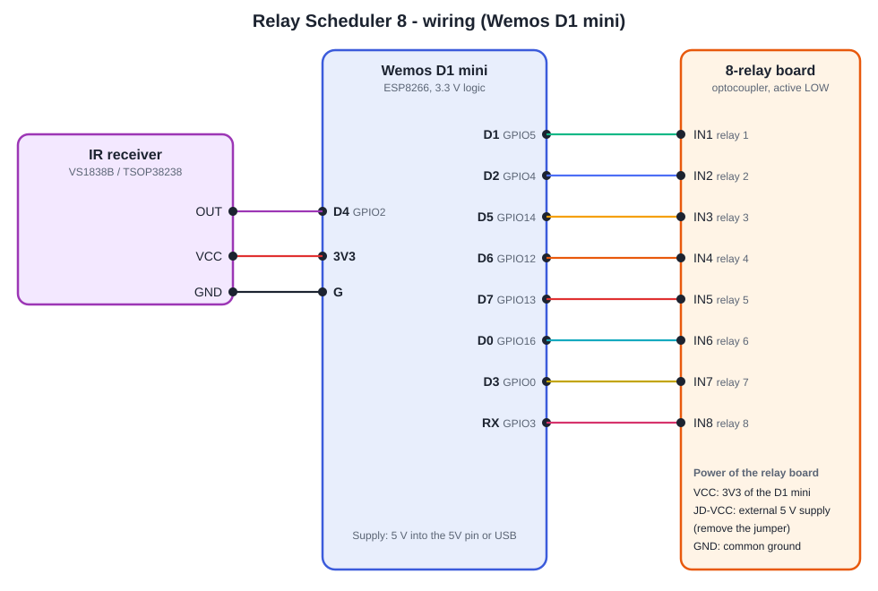

The same diagram, the pin table and the connection notes are also built into the device: **Settings → Wiring**.

* **Relay board power.** Remove the jumper between *VCC* and *JD-VCC*. Connect *VCC* to the **3V3** pin of the D1 mini
  (this powers only the optocoupler inputs, so the 3.3 V signals switch them reliably) and *JD-VCC* to the **5 V supply**
  (relay coils). All grounds are connected together.
* **IR receiver.** Data pin to **D4**, supply to **3V3**, ground to **G**. Check the pin order of your module: it differs
  between manufacturers.
* **Flashing over USB.** While the cable is connected, D3 and RX move, so relays 7 and 8 may click. Disconnect the relay
  board (or its supply) for the **first** USB flash. All later updates can be done over WiFi without any clicking.

> **Mains voltage is dangerous.** Wiring on the load side of the relays must be done by a qualified person. See [Safety](#safety).

---

## Programming the firmware


### Flash it with the Espressif Flash Download Tool

Download the tool from Espressif: <https://dl.espressif.com/public/flash_download_tool.zip>
([user guide](https://docs.espressif.com/projects/esp-test-tools/en/latest/esp32/production_stage/tools/flash_download_tool.html)).
It runs on Windows. You also need a USB **data** cable (not a charge-only cable) and, if no COM port appears, the CH340 USB driver.

**Before you start:** disconnect the relay board from the D1 mini. Relays 7 and 8 sit on D3 and RX, which the USB
programming uses (see [Wiring](#wiring)).

1. Unzip the tool and start the `.exe`.
2. In the first window choose **ChipType: ESP8266**, **WorkMode: Develop**, **LoadMode: UART**, then press **OK**.
3. Connect the D1 mini to the PC. In the **SPIDownload** tab choose its **COM** port (see *Device Manager*) and **BAUD** 115200
   (use 460800 or 921600 only if the transfer stays stable).
4. **Erase the flash first.** Press **ERASE** and wait for **FINISH**.
   *Erasing deletes everything stored in the device: settings, schedule, learned IR buttons and the licence record.
   The activation key of a licensed device stays valid and is entered again afterwards. For a device that is already
   installed, use the [update over WiFi](#over-wifi) instead.*
5. **Write the firmware.** In the first line of *Download Path Config* tick the box, choose your `.bin` file
   and type the address **`0x0`**.
6. Leave *SPI Flash Config* at its defaults (in current tool versions it follows the firmware build). If the fields can
   be edited, use **SPI SPEED 40 MHz**, **SPI MODE DIO** and a flash size of **32 Mbit (4 MB)**. Tick **DoNotChgBin** if it is shown.
7. Press **START**. The tool reads the flash and writes the file; the progress bar fills and the tool shows **FINISH** when done.
8. Disconnect and reconnect the USB cable (or press the **RST** button on the board). The device starts and opens its WiFi
   network, see [First start](#first-start).
9. Reconnect the relay board only after the firmware has started.

---

## First start

1. Power the device. With no WiFi stored, it opens its own network:
   **`RelayScheduler-XXXXXX`**, password **`relay12345`** (XXXXXX are the last digits of the chip ID).
2. Connect your phone or PC to it and open **http://192.168.4.1**.
3. Sign in with user **`admin`** and password **`admin`**. You are asked to choose a new password straight away.
4. Open **Network**, press **Scan networks**, choose your WiFi, enter its password and press **Save and restart**.
5. After the restart find the device at **http://relayscheduler.local** or at the address your router assigned
   (shown on the router, and on the dashboard under *Device → Address*). The fallback access point switches off as soon
   as the device is connected to your WiFi.
6. If the WiFi cannot be reached for 20 seconds (or is lost for 30 seconds), the access point opens again so you can
   always get back in. It retries your WiFi every two minutes while nobody is connected.

The clock is set automatically from internet time. Without internet, open the dashboard in a browser: the device takes
the time of that browser. Until the clock is known, the schedule is paused and all relays stay off.

---

## Using the web interface

### Dashboard

* **Clock, next event and today's timeline.** One lane per enabled relay shows when it is scheduled on today.
  The vertical line is the current time.
* **Outputs.** One tile per relay. Tap to switch, the tile lights up while the relay is on.
  *All on* and *All off* switch every relay.
* **Device.** Connection, address, signal strength, free memory, uptime, outputs on, IR status and licence.

### Relays

Each relay has its own block:

| Element | Meaning |
|---------|---------|
| Name | Optional, up to 16 characters. Empty means "Relay 1", "Relay 2"... in your language |
| Switch on the right | Enables or disables the schedule for this relay. A disabled relay can still be switched by hand |
| **On at / Off at** | The period. If *Off* is earlier than *On*, the relay stays on overnight until the next day |
| Weekday buttons | Days on which the period **starts** (M T W T F S S). An overnight period that starts on Friday ends on Saturday morning |
| **+ Time** | Adds another period (up to 24 per relay) |
| **Turn on / Turn off** | Switches the relay by hand, for testing |

The switch at the top (**Schedule enabled**) is the master switch for all relays. Press **Save changes** to store everything.

### Network

WiFi name and password, DHCP or fixed address, fallback access point password and the optional
[remote access](#remote-access-from-the-internet) settings.

### Settings

The settings are grouped in five tabs:

| Tab | Content |
|-----|---------|
| **General** | Language, colour theme, bar effect, account (user name and password), date and time (time zone, time server, take the time of this device) |
| **IR remote** | Switch the remote on or off and [learn its buttons](#infrared-remote-control) |
| **Wiring** | Connection diagram, pin table (with your relay names) and step-by-step connection notes, always at hand in the device |
| **Device** | Hardware and memory information, restart, factory reset, firmware update |
| **Licence** | Licence state and activation, hardware ID, PayPal donation button and QR code (10 EUR), contact, terms of use |

* **Colour themes** (Settings → General → Theme) are a feature of activated devices: Midnight, Daylight, AMOLED and a custom colour editor. On a trial device the picker is shown locked and the interface uses the default *Midnight* theme. The chosen theme is remembered in the browser and also used on the sign-in page.
* **Bar effect** (Settings → General, and on the sign-in page): a bright bar runs round the field you are typing in, a light follows the pointer across the menu bars, and on the sign-in page the card turns over when you change the language. Free for everyone; switch it off for a plain look.

---

## Infrared remote control

Any infrared remote can be used. Common protocols such as NEC, Sony, RC5, RC6, Samsung and LG are decoded
by name; unknown protocols are recognised by a fingerprint of the signal.

### Learning the buttons

1. Open **Settings → IR remote** and make sure the remote is switched **on**.
2. Press a button on your remote once, pointing it at the receiver. The code appears next to **Last received code**.
   If nothing appears, check the [receiver wiring](#wiring).
3. In the list, press **Learn** on the line you want to program. The line is highlighted and a message appears.
4. Within **20 seconds**, press the button of your choice on the remote. The code is stored and listed on that line.
5. Repeat for the other lines. Press **Cancel** to leave learn mode early, **×** to forget one button,
   **Clear all buttons** to start over.

| Line | Action |
|------|--------|
| 1 to 8 | Toggle relay 1 to 8 (the line shows the name of the relay) |
| ON | All relays on |
| OFF | All relays off |
| Clock symbol | Schedule on / off (master switch) |

Notes:

* One remote button can only do one thing. Teaching a button that is already in use moves it to the new line.
* Holding a button down does not repeat the action; it is accepted once and ignored for a short moment afterwards.
* A manual change by remote behaves like a manual change on the web page: it lasts until the next scheduled change of that relay.
* The remote keeps working when the WiFi is down.

---

## Home Assistant (MQTT)

The device talks to Home Assistant through an **MQTT broker** (for example the *Mosquitto broker* add-on of Home Assistant).
Home Assistant then creates all entities by itself (MQTT discovery), you do not write any YAML.

### Setting it up

1. In Home Assistant install the **Mosquitto broker** add-on and add the **MQTT** integration
   (*Settings → Devices & services*). Create a user for the device (*Settings → People → Users*) or use an existing one.
2. On the device open **Network → Home Assistant (MQTT)**, switch it **on** and enter the **IP address of the broker**
   (the IP address of the machine running Home Assistant), the port (1883) and the user name and password.
   Use an IP address, not a `.local` name. Press **Save**. No restart is needed.
3. The line *Status* shows **Connected** after a few seconds. In Home Assistant a new device **Relay Scheduler** appears
   under *Settings → Devices & services → MQTT*.

### What appears in Home Assistant

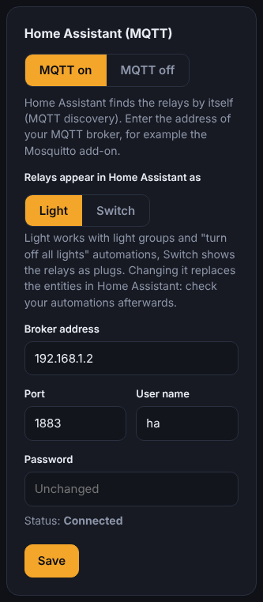

| Entity | Type | Function |
|--------|------|----------|
| Relay 1 to Relay 8 (or the names you gave them) | Light | Switch the relay on and off (`light.…`). They are lights, not plugs, so they work in light groups, areas, voice assistants and *turn off all lights* automations. The state follows every change: web page, schedule, IR remote |
| Schedule | Switch | The master switch of the whole schedule (same as the switch on the *Relays* page) |
| WiFi signal | Sensor | Signal strength in dBm (diagnostic) |

* **Light or switch:** under *Network → Home Assistant (MQTT) → Relays appear in Home Assistant as* choose **Light** (default) or
  **Switch** (power-socket icon, for plugs). Press **Save**: the device reconnects, announces the relays in the chosen type and
  removes the entities of the other type. Entity IDs change between `light.…` and `switch.…`, so check your automations afterwards.
  The MQTT command and state topics change with the type too (`<base>/light/N/…` or `<base>/switch/N/…`), and the old retained
  topics are cleared.
* A command sent from Home Assistant behaves like a manual change on the web page: it lasts until the next scheduled change
  of that relay. To keep a relay off or on for good, switch the schedule of that relay (or the *Schedule* switch) off.
* Example automation (turn *Relay 1* on at sunset and off at 23:00):

  ```yaml
  automation:
    - alias: "Relay 1 at sunset"
      trigger:
        - platform: sun
          event: sunset
      action:
        - service: light.turn_on
          target:
            entity_id: light.relay_1
    - alias: "Relay 1 off at night"
      trigger:
        - platform: time
          at: "23:00:00"
      action:
        - service: light.turn_off
          target:
            entity_id: light.relay_1
  ```

  The entity ID follows the name you gave the relay (a relay named *Garden* becomes `light.garden`). It is shown under
  *Settings → Devices & services → MQTT → Relay Scheduler*.
* When you rename a relay on the *Relays* page and press **Save changes**, the new name is sent to Home Assistant at once.
* While the device is offline (power cut, WiFi lost) Home Assistant shows its entities as *unavailable*.
* MQTT works only when the device is connected to your WiFi, not in the fallback access point.
* The connection to the broker is plain MQTT without TLS, like the web page. Keep the broker inside your home network.
* Nothing is switched by MQTT when the trial is over and the device is not activated.

### Topics (for other MQTT clients)

The base topic is `relayscheduler/<chip id>`; the chip id is the last six digits of the name of the fallback access point.

| Topic | Direction | Content |
|-------|-----------|---------|
| `<base>/status` | device → broker | `online` / `offline` (retained, `offline` is the last will) |
| `<base>/light/N/state` | device → broker | `ON` / `OFF`, N = 1 to 8 (retained). Used when the relays appear as **lights** |
| `<base>/light/N/set` | broker → device | `ON` / `OFF` (lights) |
| `<base>/switch/N/state` | device → broker | `ON` / `OFF`, N = 1 to 8 (retained). Used when the relays appear as **switches** |
| `<base>/switch/N/set` | broker → device | `ON` / `OFF` (switches) |
| `<base>/schedule/state` | device → broker | `ON` / `OFF` (retained) |
| `<base>/schedule/set` | broker → device | `ON` / `OFF` |
| `<base>/rssi` | device → broker | WiFi signal in dBm, every 60 s |
| `homeassistant/<type>/rs_<MAC>_.../config` | device → broker | Discovery messages (retained) |

Only the topics of the selected type (light or switch) are active. When you change the type, the device also changes the
command and state topics and removes the old discovery entry and the old retained state.

The device also listens to `homeassistant/status`: when Home Assistant starts it sends all states and discovery messages again.

---

## Remote access from the internet

The device can additionally listen on a second port, so you can reach it from mobile data while the normal address keeps working at home.

1. **Network → Remote access**: switch it **on**, enter your **DNS name** (for example from a dynamic DNS service
   or your internet provider) and choose a **Remote port** (not 80).
2. Press **Save and restart**. The page shows the address to use, for example `http://myname.example.com:8080`.
3. In your **router**, forward that external port to the IP address of the device, same port number.
   Give the device a fixed address (or a DHCP reservation) so the forwarding keeps working.
4. Test from mobile data with WiFi switched off on the phone.

Details:

* **Local access always stays on port 80.** The fallback access point is also always on port 80.
* The DNS name is only shown by the page. The device does not update your DNS record; use your router or
  the DNS provider's tool for that.
* If your provider uses carrier-grade NAT (CGNAT), port forwarding is not possible. Use a VPN
  (WireGuard, Tailscale) to your home network instead.

> **The connection is plain HTTP, not encrypted.** Anyone on the path can read the password. If you forward a port to the internet,
> use a long password and a non-standard port, or better: use a VPN and keep the device reachable only from inside.

---

## Behaviour in detail

* **Power-up.** All relays are OFF. When the clock is known, every enabled relay takes the state its schedule demands
  *right now*. A relay whose period is running when power returns switches on again.
* **Switching.** A relay changes only when one of its periods starts or ends, or when you press **Save changes**.
  Between those moments you can override it by hand (web page or remote) and it stays that way.
* **Saving the schedule** applies the current scheduled state to every enabled relay immediately.
* **Several periods on one relay** are combined: the relay is on while **any** period is active.
* **Master switch off.** The scheduler stops, the relays keep their current state, manual control still works.
  Use *All off* to switch everything off.
* **Clock unknown.** The schedule is paused and the relays keep their state (all off after power-up).
* **Time resolution.** Periods start and end on full minutes.
* **Trial over.** When the trial period has ended and the device is not activated, all relays are switched off, the
  schedule and the remote stop, and the page shows the activation screen. See [Licence](#licence-and-trial).
* **Daylight saving.** Handled by the time zone rule. Times are always local time.

---

## Licence and trial

* The device runs free for a **30-day trial** (30 days of running time). Changing the clock does not extend it,
  and neither a factory reset nor a firmware update restarts it.
* After the trial the schedule stops and the sign-in page is replaced by an activation page with the hardware ID and a
  field for the **activation key**.
  Once accepted it is permanent.
* The key can also be entered during the trial: **Settings → Licence**.
---

## Updating and factory reset

### Over WiFi

1. Build the `.bin` as described in [Programming the firmware](#1-compile-the-bin-file) (*Sketch → Export Compiled Binary*).
2. **Settings → Device → Firmware**, choose the `.bin` file, press **Install update**.
   The device restarts by itself. Updates are accepted only after the default password has been changed.
3. Settings, schedule, learned IR buttons and the licence are kept.

### Backup and restore (files)


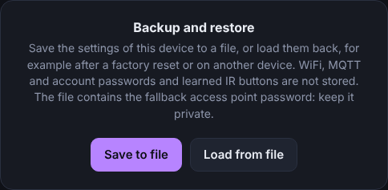

* **Schedule:** *Relays → Save to file / Load from file*. The file holds the master switch, the relay names, each relay's on/off switch and all periods. Loading replaces the whole schedule and applies it at once.
* **Configuration:** *Settings → Device → Backup and restore*. The file holds the network settings (including the fallback access point password), Home Assistant (MQTT) address, port and user, the time zone and time server, and the IR on/off switch. WiFi, MQTT and account passwords and learned IR buttons are **not** stored. Loading changes the network settings only when they differ, and the device then restarts.
* Both files are plain JSON text, named with the chip ID and the date. Colour theme and bar effect are stored in the browser and are not part of the files.

### Factory reset

* **From the web page:** *Settings → Device → Factory reset*. Erases WiFi, password, schedule and learned IR buttons.

The licence and the trial counter are **not** erased by a factory reset.

After a factory reset the device is again reachable at `RelayScheduler-XXXXXX` / `http://192.168.4.1` with `admin` / `admin`.

---

## Troubleshooting

| Problem | What to check |
|---------|---------------|
| No COM port appears when the D1 mini is connected | Use a USB data cable, try another port, install the CH340 driver |
| The Flash Download Tool cannot connect | Close the Arduino IDE and serial monitors, lower BAUD to 115200, disconnect the relay board, or use the D3-to-GND method in [Programming the firmware](#programming-the-firmware) |
| The device does not start after flashing | Erase the flash first, write the `.bin` file at address `0x0` only, then power the board again. If it still does not start, try SPI MODE DOUT |
| Cannot find the device | Look for the WiFi network `RelayScheduler-XXXXXX` and open `http://192.168.4.1`. Otherwise read the address from your router |
| Relays are inverted (on when they should be off) | Your board is active HIGH: set `RELAY_ACTIVE_LOW` to `0` in `Config.h` and upload again |
| A relay clicks while uploading over USB | Normal for relays 7 and 8 (D3 and RX). Disconnect the relay board for the first USB upload |
| Schedule does nothing | Master switch on? Relay enabled? Clock shown on the dashboard? Day buttons selected? Trial still valid? |
| Relay switches one hour off | Check the time zone in *Settings → General → Date and time* |
| No code appears in *Last received code* | Check receiver wiring (OUT to D4, VCC to 3V3, GND). Remotes of some devices send nothing until a button is pressed firmly. Try another remote |
| Learned button does nothing | Is *IR remote* switched on? Is the code exactly the one shown when you press that button? Another remote may have a different code |
| "Another device is signed in" | Only one device can be signed in. Sign out on the other one, or wait 5 minutes |
| Locked out after failed sign-ins | Three wrong passwords cause a one-minute pause |
| Forgot the password | There is no hardware reset button. Contact contact@digital250v.eu |
| Cannot reach the device from the internet | Port forwarding to the right IP and port? Fixed address for the device? CGNAT at your provider? Test from mobile data |
| Status stays *Not connected* | Broker address is the IP of the machine running the broker? Port 1883? User name and password right (Home Assistant: the user must exist)? Broker add-on running? The device retries every 5 to 60 seconds |
| No device in Home Assistant | The MQTT integration must be set up with the same broker, and *Enable discovery* must be on (default). Restart Home Assistant or press **Save** on the device to send the discovery again |
| Update does not start | Change the default password first. The `.bin` must be built for the 4 MB flash layout with OTA space |

---

### Specifications

| | |
|--|--|
| Controller | ESP8266 (Wemos D1 mini), 160 MHz, 4 MB flash |
| Outputs | 8 relays, 3.3 V logic signals, active LOW by default |
| Periods | 24 per relay, minute resolution, per-period weekdays |
| IR remote | 11 learnable buttons, receiver on D4, decoding by IRremoteESP8266 |
| Home Assistant | MQTT 3.1.1 with discovery, library PubSubClient, no TLS |
| Settings storage | Emulated EEPROM in flash with CRC; written only when something changed |
| Web interface | Stored compressed in flash (about 70 KB), no internet access needed |
| Web server | optional port |
| Hostname | `relayscheduler.local` |
| Fallback access point | `RelayScheduler-XXXXXX`, `192.168.4.1`, password `relay12345` (changeable) |
| Session | One signed-in device, idle time-out 5 minutes |

### Limits

* Relay name: 16 characters.
* Periods per relay: 24 (`MAX_TIMERS` in `Config.h`; changing it changes the settings layout).
* A period's ON and OFF times must differ.

---

## Safety

* Relay boards switch **mains voltage** in many installations. Work on mains wiring must be done by a qualified person,
  with the supply disconnected. Use relays, wiring and fuses rated for the load.
* Heaters, pumps, motors and similar loads must be suitable for automatic, unattended switching and be protected
  against overload and overheating.
* Decide what must happen when power returns or the clock is wrong. After a power cut **every relay starts off** and
  follows the schedule once the clock is known.
* This device is not a safety device. Do not use it for life support, fire protection, alarms or emergency functions.
* Change the default password and keep the device off the open internet unless you use a VPN.

---

## Contact

Team DigitalEQ · [contact@digital250v.eu](mailto:contact@digital250v.eu)
